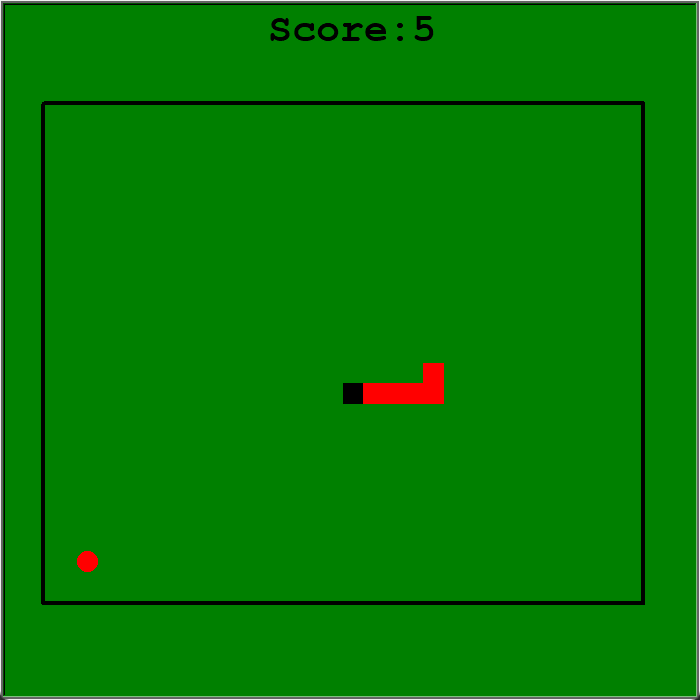

# Snake Game

The classic Snake game, built in Python with the built-in `turtle` module. Eat the red fruit to grow longer and score points, and don't hit the wall or your own tail. The snake gets a little faster with every fruit.

## Screenshot



## Controls

| Key | Action |
|---|---|
| ↑ ↓ ← → | Change direction |

## Getting started

No packages to install. You only need Python 3 (on Linux, make sure Tkinter is installed, for example `sudo apt install python3-tk`).

```bash
git clone https://github.com/balankdharan/snakegameUI.git
cd snakegameUI
python main.py
```

Press an arrow key to start moving.

## How it works

- The snake head and every fruit are `turtle` objects. When the snake eats, a new square is added and each piece of the tail follows the one in front of it.
- The game loop redraws the screen, checks for fruit, wall and tail collisions, then waits a short delay. That delay gets shorter as your score goes up.
- Hitting the wall or your tail shows a **Game Over** screen with your score.
